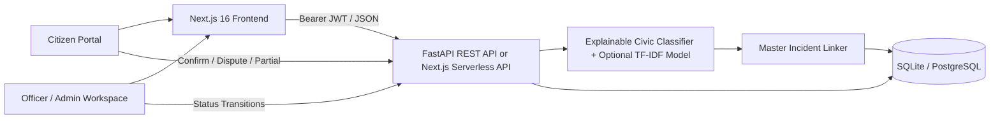
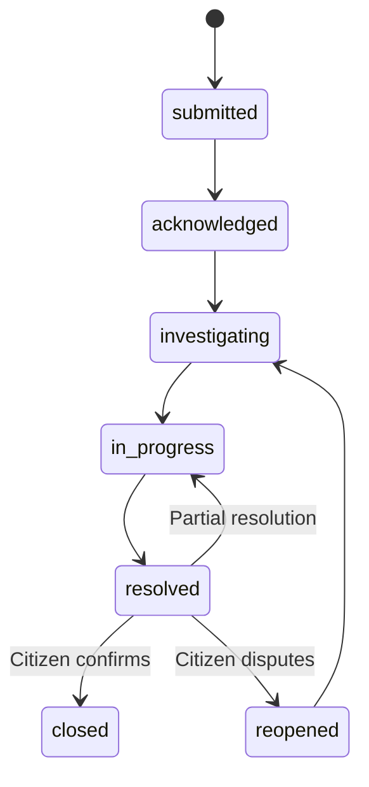

# JAN-SUTRA AI

**Multilingual Civic Grievance Intelligence, Master Incident Linking & Citizen-Verified Municipal Operations Platform**

[](https://jan-sutra-ai.vercel.app/)
[](https://nextjs.org/)
[](https://react.dev/)
[](https://tailwindcss.com/)
[](https://fastapi.tiangolo.com/)
[](https://python.org/)
[](https://scikit-learn.org/)

> **Live Application:** [https://jan-sutra-ai.vercel.app/](https://jan-sutra-ai.vercel.app/)  
> **Repository:** [https://github.com/shivangsaxena1011/Jan-Sutra-AI](https://github.com/shivangsaxena1011/Jan-Sutra-AI)

---

## Table of Contents

1. [Project Foundation & Problem Statement](#project-foundation--problem-statement)
2. [System Architecture](#system-architecture)
3. [Core Capabilities & Portal Routes](#core-capabilities--portal-routes)
4. [Civic Intelligence & ML Pipeline](#civic-intelligence--ml-pipeline)
5. [Data Model & REST API Reference](#data-model--rest-api-reference)
6. [Technology Stack](#technology-stack)
7. [Repository Structure](#repository-structure)
8. [Running Locally](#running-locally)
9. [Demo Accounts & Testing](#demo-accounts--testing)
10. [Deployment & Documentation](#deployment--documentation)

---

## Project Foundation & Problem Statement

**JAN-SUTRA AI** is a full-stack civic-tech prototype designed to modernize municipal grievance redressal across Indian urban local bodies (demonstrated using **Bhopal Municipal Corporation — Ward 12 / Arera Colony** scenarios).

Traditional municipal grievance portals break down across three operational bottlenecks:

| Challenge | Root Cause | JAN-SUTRA AI Approach |
|---|---|---|
| **Triage & Linguistic Friction** | Citizens describe issues naturally in Hindi, English, or Hinglish (e.g., *"Naali ka paani sadak par aa raha hai"*), but legacy forms force manual department selection. | **BhashaBridge Intake**: Detects language (`hi` / `hinglish` / `en`), classifies the civic domain, assigns priority (`P1`–`P3`), and suggests the responsible department with an explainable routing reason. |
| **Duplicate Complaint Overload** | Multiple residents report the same burst water line or road failure, creating isolated tickets for one underlying fault. | **Master Incident Linking**: Groups related open complaints sharing the same category and ward within a 14-day window under a unified Master Incident while preserving each citizen's individual tracking code. |
| **Unverified Closures** | Tickets can be marked resolved internally without citizen confirmation, eroding public accountability. | **Citizen-Certified Closure**: Officers can transition cases up to `resolved`, but final `closed` status is controlled exclusively by the citizen verification workflow (`confirmed`, `disputed`, or `partial`). |

---

## System Architecture

JAN-SUTRA AI supports two runtime modes using a shared API contract (`/api/v1`):

1. **Full-Stack Hybrid Mode (FastAPI + SQLAlchemy + PostgreSQL/SQLite):** Persistent relational storage, Argon2 password hashing, HS256 JWT authentication, role-based access control, and optional scikit-learn model inference.
2. **Standalone Serverless Mode (Next.js App Router):** Built-in serverless route handler (`apps/web/app/api/v1/[...route]/route.ts`) backed by an in-memory demonstration store for zero-config evaluation on Vercel.



### Complaint Lifecycle & Governance Rule



> Officers and administrators cannot directly close a complaint; closure requires citizen verification via `POST /api/v1/complaints/{id}/verify`. Staff may mark invalid submissions as `rejected` with an auditable note.

---

## Core Capabilities & Portal Routes

| Route | Portal / Module | Functionality |
|---|---|---|
| `/` | **Landing Page** | Overview of platform architecture, capabilities, theme toggle (dark/light), and portal entry points. |
| `/login`, `/register` | **Authentication & Onboarding** | Role-based sign-in (with one-click demo credential switching) and citizen self-registration. |
| `/citizen` | **Citizen Hub** | Personal grievance metrics, active ticket tracking, and pending resolution verification prompts. |
| `/submit` | **BhashaBridge Intake** | Guided conversational grievance submission supporting Hindi, Hinglish, and English with live triage suggestions. |
| `/complaints/[id]` | **Case History & Verification** | Full chronological audit trail (`ComplaintEvent` timeline), resolution evidence view, and citizen confirm/dispute actions. |
| `/officer` | **Officer Operations Queue** | Filterable departmental queue for advancing ticket statuses (`acknowledged` → `investigating` → `in_progress` → `resolved`). |
| `/incidents` | **Master Incidents & Digital Twin** | Aggregated `INC-*` register linked to individual `JS-*` complaints alongside a ward spatial node visualizer. |
| `/radar` | **CivicPulse 72h Radar** | Interactive UI demonstration of predictive infrastructure risk hotspots and pre-emptive dispatch workflows. |
| `/model-lab` | **AI/ML Observability Lab** | Telemetry dashboard showcasing model architecture concepts and pipeline inspection UI. |
| `/transparency` | **Ward Health Scorecards** | Public accountability leaderboard displaying ward resolution metrics and closure authenticity distributions. |

> **Scope Note:** The authentication, triage, complaint lifecycle, incident linking, analytics overview, and citizen verification workflows are backed by live REST endpoints. Spatial GIS layers, `/radar` forecasts, and `/model-lab` telemetry are prototype UI visualizations (see [docs/validation-and-scope.md](docs/validation-and-scope.md)).

---

## Civic Intelligence & ML Pipeline

The backend triage engine (`apps/api/app/services/intelligence.py`) prioritizes **explainability** over opaque black-box routing:

1. **Language Detection:** Identifies Devanagari Unicode script (`hi`), Romanized Hindi/Hinglish keywords (`hinglish`), or defaults to English (`en`).
2. **Rule-Based Classification:** Matches input against curated civic vocabularies across **7 core categories** (*Water Supply*, *Drainage & Sewerage*, *Roads & Potholes*, *Waste Management*, *Street Lighting*, *Electricity*, *Public Infrastructure*) with a *General Civic Issue / Municipal Helpdesk* fallback when confidence is low.
3. **Optional ML Fallback (`scikit-learn`):** When keyword rules yield zero matches, the pipeline consults `artifacts/grievance_classifier.joblib` — a `TfidfVectorizer(analyzer="char_wb", ngram_range=(2, 5))` + balanced `LogisticRegression` classifier trained via `apps/api/training/train_classifier.py`.
4. **Priority Scoring:** Assigns `P1` (urgent safety/hospital/school/flood/electrocution signals), `P2` (matched civic category), or `P3` (unclassified general triage).
5. **Master Incident Clustering:** Links new reports to the most recent open/investigating/in-progress incident matching the same `category` and `ward` created within the last 14 days, or opens a new `INC-*` record.

---

## Data Model & REST API Reference

### Database Entities (`apps/api/app/models/entities.py`)
- **`User`**: Citizen, officer, and administrator accounts with Argon2 password hashes, ward assignment, and preferred language.
- **`Department`**: Municipal wings (`WATER`, `DRAIN`, `ROADS`, `WASTE`, `LIGHT`, `HELP`) with default SLA hours.
- **`CivicAsset`**: Geo-tagged municipal infrastructure records (`asset_code`, `ward`, `latitude`, `longitude`).
- **`Incident` (`master_incidents`)**: Clustered `INC-*` parent incidents tracking `linked_complaints` and overall status.
- **`Complaint`**: Individual citizen `JS-*` tickets with `confidence`, `routing_reason`, `citizen_verification`, and `resolution_note`.
- **`ComplaintEvent`**: Immutable audit log of status changes, submissions, and citizen verification actions.

### Core API Endpoints (`/api/v1`)

| Method | Endpoint | Access | Description |
|---|---|---|---|
| `GET` | `/health` | Public | Service health and active environment status. |
| `POST` | `/api/v1/auth/register` | Public | Register a new citizen account and issue JWT. |
| `POST` | `/api/v1/auth/login` | Public | Authenticate user and return Bearer token. |
| `GET` | `/api/v1/auth/me` | Authenticated | Return current authenticated user profile. |
| `GET` | `/api/v1/departments` | Authenticated | List configured municipal departments and SLAs. |
| `POST` | `/api/v1/assistant/triage` | Optional Auth | Analyze complaint text and return category, priority, and localized reply. |
| `POST` | `/api/v1/complaints` | Authenticated | Submit complaint, classify, and link/create Master Incident. |
| `GET` | `/api/v1/complaints` | Authenticated | List complaints (scoped to owner for citizens; all for staff). |
| `GET` | `/api/v1/complaints/{id}` | Authenticated | Fetch single complaint details and full `ComplaintEvent` timeline. |
| `PATCH` | `/api/v1/complaints/{id}/status` | Officer / Admin | Transition complaint status and record resolution notes. |
| `POST` | `/api/v1/complaints/{id}/verify` | Authenticated | Citizen confirmation (`confirmed`), dispute (`disputed`), or partial fix. |
| `GET` | `/api/v1/incidents` | Officer / Admin | List Master Incidents and linked complaint counts. |
| `GET` | `/api/v1/analytics/overview` | Authenticated | Role-scoped summary metrics and resolution rates. |

---

## Technology Stack

| Layer | Technologies |
|---|---|
| **Frontend** | Next.js 16.3 (App Router), React 19.2, TypeScript 5.8, Tailwind CSS 4.3, Lucide React |
| **Backend API** | Python 3.12+, FastAPI 0.162, Uvicorn, Pydantic Settings |
| **Database & ORM** | SQLAlchemy 2.0+, PostgreSQL (`psycopg 3`) for production/Docker, SQLite for local development |
| **ML & NLP** | scikit-learn 1.6+ (TF-IDF character n-grams + Logistic Regression), Joblib, Pandas |
| **Security** | Argon2 (`argon2-cffi`), HS256 JWT (`PyJWT`), strict CORS & security headers (`nosniff`, `X-Frame-Options: DENY`) |
| **Infrastructure** | Docker & Docker Compose, Vercel (`vercel.json` root monorepo build) |

---

## Repository Structure

```text
Jan-Sutra-AI/
├── apps/
│   ├── api/                        # FastAPI backend & ML pipeline
│   │   ├── app/
│   │   │   ├── api/                # Route handlers & RBAC dependencies
│   │   │   ├── core/               # Config, DB session, Argon2/JWT security
│   │   │   ├── models/             # SQLAlchemy ORM entities
│   │   │   ├── schemas/            # Pydantic request/response schemas
│   │   │   └── services/           # Explainable classifier & ML loader
│   │   ├── artifacts/              # Trained joblib classifier artifact
│   │   ├── scripts/                # seed_demo.py & create_staff.py
│   │   ├── tests/                  # pytest API & intelligence test suites
│   │   └── training/               # Starter CSV & train_classifier.py
│   └── web/                        # Next.js 16 frontend & serverless API
│       ├── app/                    # App Router pages & /api/v1 route handler
│       ├── components/             # Shared UI frame, auth, theme, badges
│       └── lib/                    # Typed API client & domain types
├── docs/
│   ├── architecture.md             # System boundaries & evolution roadmap
│   ├── model-card.md               # Classifier limitations & evaluation criteria
│   └── validation-and-scope.md     # Verified checks & release boundaries
├── docker-compose.yml              # Full PostgreSQL + FastAPI + Next.js stack
├── package.json                    # Root npm workspace configuration
└── vercel.json                     # Vercel monorepo deployment config
```

---

## Running Locally

### Prerequisites
- **Node.js** v20.9+ (v22 LTS recommended)
- **Python** 3.12+
- **Docker** *(optional, for containerized full-stack execution)*

### Option A: Local Development (FastAPI + Next.js)

From the project root directory, start the **FastAPI backend**:

```bash
cd apps/api
python -m venv .venv

# Windows (PowerShell):
.\.venv\Scripts\Activate.ps1
# Linux / macOS:
source .venv/bin/activate

pip install -r requirements.txt
python -m scripts.seed_demo
python -m uvicorn app.main:app --reload --port 8000
```

- Swagger UI: `http://localhost:8000/docs`
- Health Check: `http://localhost:8000/health`

In a separate terminal at the project root, start the **Next.js frontend**:

```bash
npm install
npm --workspace apps/web run dev
```

- Web Portal: `http://localhost:3000`
- *(Optional)* Set `NEXT_PUBLIC_API_URL=http://localhost:8000/api/v1` in `apps/web/.env.local` to point the frontend to FastAPI instead of the built-in Next.js serverless API routes.

### Option B: Docker Compose (PostgreSQL + FastAPI + Next.js)

Run the entire stack with a single command from the project root:

```bash
docker compose up --build -d
```

- Web Application: `http://localhost:3000`
- FastAPI Backend: `http://localhost:8000`
- PostgreSQL: `localhost:5432`

---

## Demo Accounts & Testing

### Pre-Seeded Demonstration Credentials

| Role | Email | Password | Portal Access |
|---|---|---|---|
| **Citizen** | `citizen@jansutra.in` | `Citizen@123` | Citizen Hub, BhashaBridge Intake, Case Verification |
| **Officer** | `officer@jansutra.in` | `Officer@123` | Operations Queue, Master Incidents, Status Updates |
| **Administrator** | `admin@jansutra.in` | `Admin@123` | Full Municipal Oversight, Incident Register, Analytics |

> Staff accounts can also be provisioned securely via CLI:  
> `python -m scripts.create_staff --name "Officer Name" --email name@agency.gov.in --role officer --ward "Ward 12"`

### Verification & Training Commands

```bash
# Backend unit & lifecycle tests
cd apps/api && pytest

# Retrain optional TF-IDF grievance classifier
cd apps/api && python training/train_classifier.py --input training/data/grievances.csv

# Frontend production build & lint check
npm run build
npm run lint
```

---

## Deployment & Documentation

- **Zero-Config Vercel Deployment:** Root `vercel.json` builds `apps/web` with native `/api/v1/[...route]` serverless handlers for instant preview/production hosting.
- **Hybrid Production Deployment:** Host `apps/web` on Vercel (with `NEXT_PUBLIC_API_URL` configured) and `apps/api` on Railway, Render, or Google Cloud Run backed by managed PostgreSQL and a 32+ character `JWT_SECRET`.

### Technical Documentation
- [Architecture Notes](docs/architecture.md) — System boundaries, complaint state diagram, and production evolution roadmap.
- [Model Card](docs/model-card.md) — Intended use, starter dataset details, known limitations, and pre-deployment evaluation requirements.
- [Validation & Release Scope](docs/validation-and-scope.md) — Verified checks and explicit prototype boundaries.
