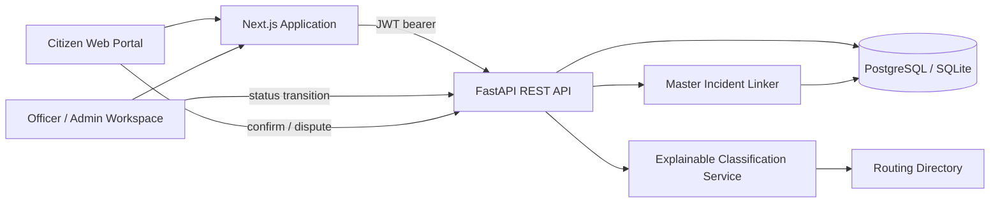
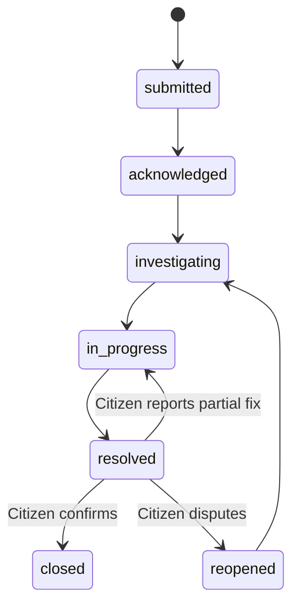

# JAN-SUTRA AI — Architecture Notes

## System boundary

## Complaint lifecycle

`closed` is not available as an officer-entered transition. The citizen verification endpoint controls closure. Staff can still reject a case with an auditable note; production deployments should add mandatory reason codes and an appeal period for rejection.

## Intelligence pipeline

1. Preserve the original citizen text.
2. Detect a basic language label (Hindi script, a small Hinglish phrase list, or English fallback).
3. Evaluate transparent civic term rules.
4. Optionally consult a locally trained TF-IDF character n-gram classifier.
5. Produce category, responsible-department suggestion, baseline confidence, priority suggestion and a human-readable reason.
6. Search for an open incident with the same category and ward within 14 days.
7. Link the complaint to the matching incident, or create a new master incident.

The current incident resolver does **not** perform cross-lingual embeddings, geospatial distance clustering, asset graph reasoning or probabilistic root-cause analysis. The data model and API are arranged so those services can replace the initial strategy.

## Recommended production evolution

- Add PostGIS geometry columns and verified ward/department polygons.
- Use multilingual sentence embeddings or an Indic-language transformer for semantic complaint retrieval.
- Make candidate incident matches explainable with text, time, distance and asset signals.
- Require review when match confidence is below a validated threshold; retain merge/split audit events.
- Add an asset graph for pipes, drains, road segments, streetlights and service zones.
- Add Alembic migrations, transactional outbox, background workers and delivery retries.
- Move authentication behind a secure same-origin BFF with HttpOnly cookies and CSRF protection.
